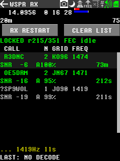

# WSPR RX

WSPR RX receives standard WSPR messages containing a callsign, four-character
Maidenhead locator and transmitted power. It is a receive-only external app;
install `wspr_rx.ppma` and the matching Mayhem firmware/application set.

Reception demonstration: https://youtu.be/VbYk4-VxHH8

## Protocol

A standard WSPR transmission carries a callsign, locator and power in 162
four-tone symbols over about 110.6 seconds. Transmissions normally start near
the beginning of an even UTC minute. Tone spacing is about 1.465 Hz. The power
field is the transmitter's declared dBm value, not a measurement by this app.

## Using the app

Open **Receive → WSPR** from the device menu. Serial `appstart` has caused
faults on earlier builds and is not a validated startup path.

Choose the band preset or dial frequency and set receiver gain for your antenna.
The initial fallback is 40 m (7.0386 MHz). Saved radio settings override it.
For 20 m use the USB dial frequency **14.0956 MHz**. Displayed station
frequencies are audio offsets from the dial, not RF frequencies.

Reception continues across WSPR slots. Starting during a transmission may miss
that packet; leave the app running for subsequent complete transmissions.
Correct UTC is useful for comparing observations with another receiver, but
reception does not require manually aligning app startup to a slot.

## Display and controls

- **CALL / N / GRID / FREQ:** station callsign, counted observations, locator
  and audio frequency in Hz. Scroll the list to see additional stations.
- **SNR:** the decoder's approximate signal-to-noise estimate in dB. It has
  not been calibrated against other receivers.
- **A%:** agreement between the decoded message, re-encoded, and the received
  symbol decisions. This is not agreement between separate receptions and
  not a probability that a callsign is correct.
- **`? CALL` (grey):** a decoded message awaiting an independent repeat.
- **Green callsign:** the same callsign, locator and transmitted power were
  decoded from a second independent onset while the record was retained.
  There is no 12-minute acquisition limit. Frequency changes do not reset
  confirmation; a changed locator or power starts confirmation again.
- **N:** counted observations of the callsign, including earlier payloads,
  saturated at 999. Same-onset re-decodes do not count or confirm, even when
  their frequency estimates differ. Records are bounded and can be evicted.
- **Age:** time since the latest counted observation. Silence does not clear
  an already-confirmed record.
- **`... frequency age`:** a recent selected search hypothesis without an
  accepted report. It is not a decoded station and expires after 150 seconds.
- **RX RESTART:** restart capture/decoding while retaining the station list.
- **CLEAR LIST:** clear station history and confirmation state.

Confirmation means repeat evidence, not external verification that a station
exists. WSPR messages have no CRC and false decodes remain possible.

## Memory and build integration

The WSPR baseband has a dedicated 4 KiB decoder-thread stack and a separate
1 KiB main/event stack. Its primary linker script is generated from upstream
with only the WSPR main-stack reservation changed. Other applications and the
global M0/M4 stack defaults are unchanged. The link fails if WSPR cannot retain
its required heap reserve.

## Logging

Ordinary builds do not create or append WSPR SD logs. Saved application settings
still use the SD card; existing logs are left in place.

Optional diagnostic compiler definitions are `WSPR_SD_LOGGING=1` and, for sampled
candidate records, `WSPR_CANDIDATE_TRACE=1`. Apply matching definitions to M0 and
M4 with the project's build toolchain; these are compiler definitions, not
standalone CMake options. Defaults are zero. Debug output uses
`LOGS/WSPR_DEBUG.TXT`; confirmed reports use `LOGS/WSPR.TXT`.

The debug gate normally allows a status entry every 60 seconds, with additional
entries on state changes or decodes. A candidate record can add another SD
write. Detailed candidate records are a sample, not the complete population.

## Limitations and development

This is an initial receiver implementation. Weak-signal performance is not
benchmarked against established WSPR receivers. Identical payloads have been
observed at frequencies about 99 Hz apart; same-onset ambiguity is excluded from
confirmation, but the underlying reception artifact is unresolved.

The decoder supports standard callsign/locator/power messages. Do not assume
support for every extended WSPR message type. Host tests are documented in
`firmware/test/baseband/wspr/README.md`.
